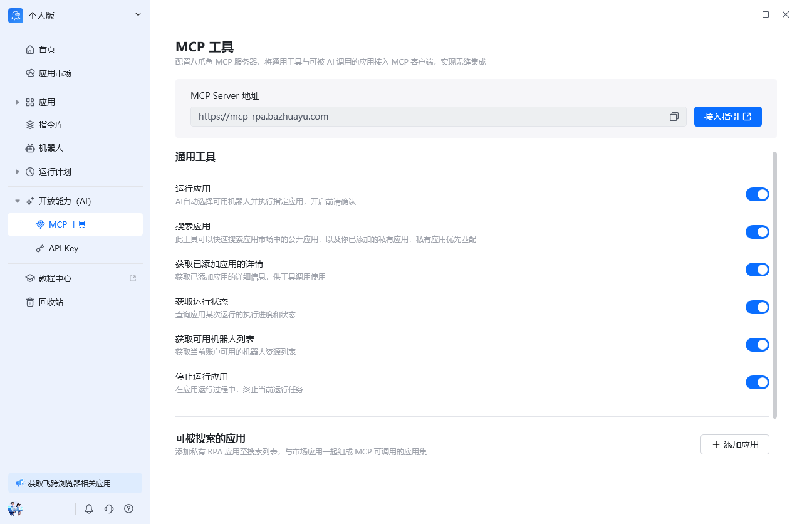
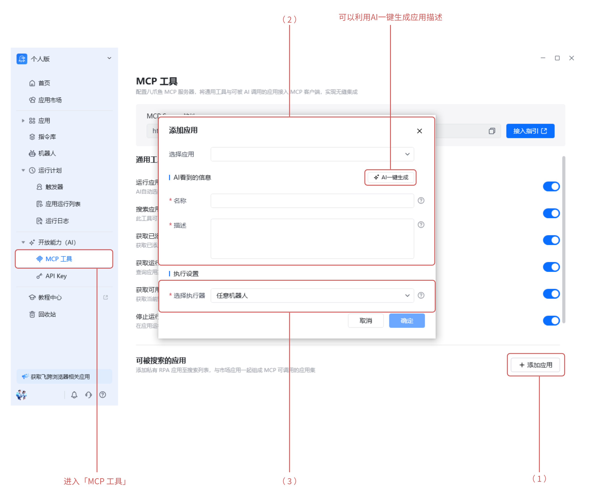
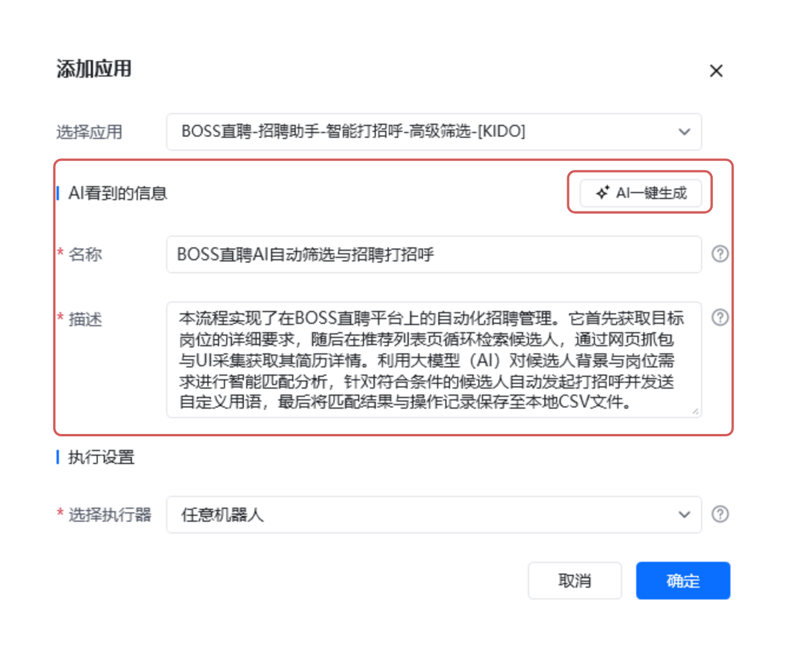
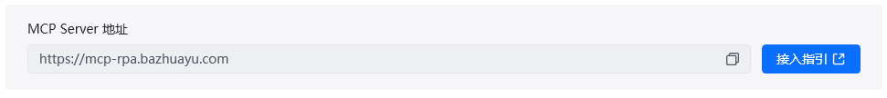
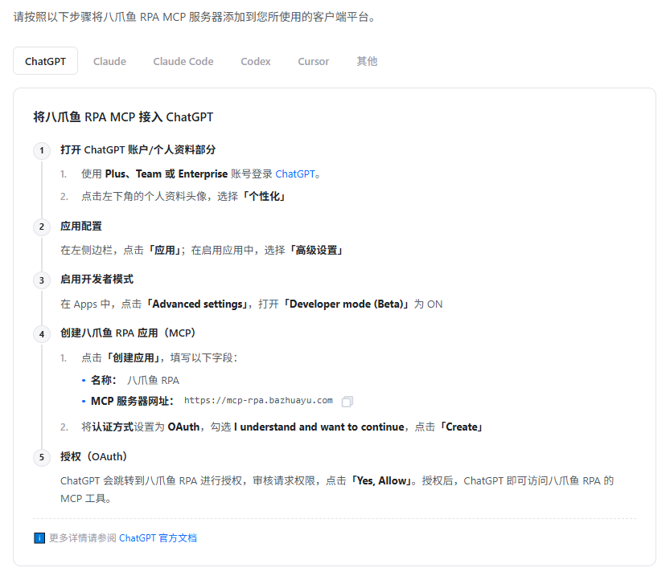
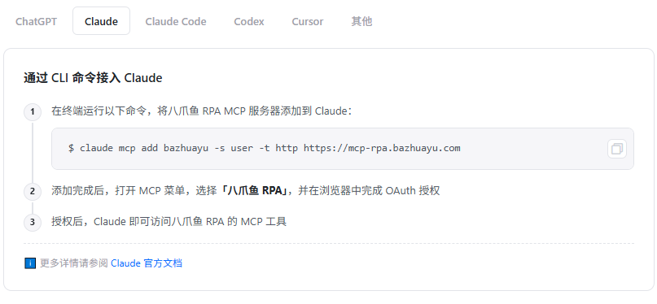
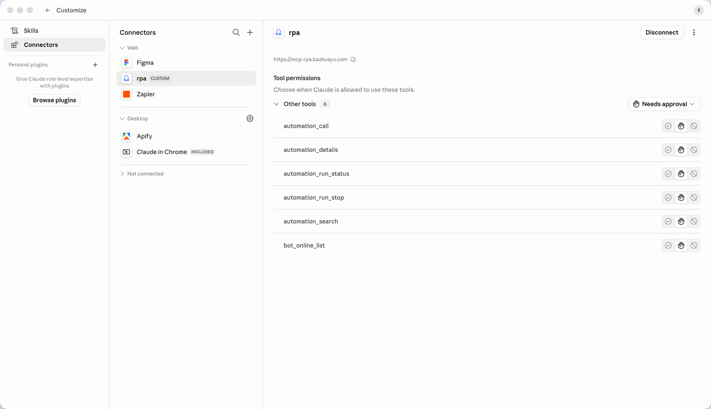
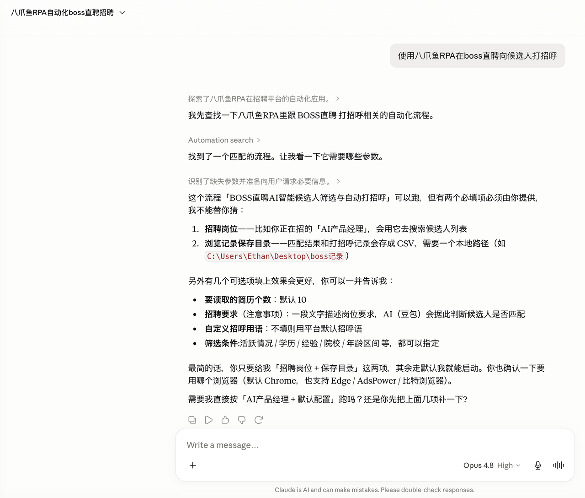

> **让 AI 拥有"双手"，用自然语言就能指挥自动化流程。**

> 八爪鱼 RPA 现已支持 MCP（Model Context Protocol）协议。简单来说，就是把你的 RPA 流程变成 AI 可以调用的"工具"，让 AI 不仅能"想"，还能"做"。

---


## 一、什么是 MCP？

想象你请了一位非常聪明的助手（AI），但它只能动嘴不能动手。而你有许多重复性的电脑操作需要完成——比如每天登录系统导出报表、在招聘网站筛选简历、批量处理文件等。

MCP 就像是给这位助手配了一双手（RPA）。现在你只需要说：“帮我导出昨天的销售报表”，AI 就能理解你的意图，并指挥 RPA 自动完成登录、点击、下载等一系列操作。

简短版：AI 是大脑，RPA 是双手，MCP 是连接大脑和双手的神经系统。


## 二、核心功能



八爪鱼 RPA MCP 提供了以下通用工具，供 AI 客户端调用：

| 工具名称 | 功能说明 |
| --- | --- |
| 运行应用 | AI 自动选择合适的机器人，执行指定的 RPA 应用 |
| 搜索应用 | 快速搜索应用市场中的公开应用，以及你的私有应用 |
| 获取应用详情 | 查看某个应用的具体信息，了解它需要哪些参数 |
| 获取运行状态 | 查询正在运行的任务进度和状态 |
| 获取可用机器人列表 | 查看当前账户下有哪些机器人资源可用 |
| 停止运行应用 | 在应用运行过程中，终止当前任务 |


## 三、适用场景

#### 场景一：AI 操作没有 API 的老系统

很多企业的内部系统（如 ERP、CRM）没有开放接口，或者一些政府网站、旧版网页无法直接对接。以前需要人工一步步操作，现在可以让 AI 通过 RPA 来"操作"这些系统——就像有个看不见的助手在帮你点点点。

#### 场景二：一句话触发自动化

在 AI 对话中直接说：“帮我筛选本周的简历并发送面试邀请”，AI 就能自动调用对应的 RPA 流程，无需你手动打开八爪鱼客户端。

#### 场景三：给企业 AI 助手"升级"

如果你公司有企业微信机器人、钉钉智能助手或自研的 AI 平台，可以把 RPA 能力接入进去。员工在群里 @机器人说"导出上月的考勤数据"，机器人就能自动完成。


## 四、如何使用

### 方式一：自建应用（推荐）

适合：有自己开发的 RPA 流程，想开放给 AI 使用

#### 步骤 1：配置要开放的应用



登录八爪鱼客户端，进入「开放能力 (AI)」→「MCP 工具」：

（1）点击「添加应用」，选择你要开放的 RPA 流程

（2）给这个工具起个清晰的名字，写一段描述（这很重要，AI 靠这个理解这个工具是干嘛的）

（3）选择执行机器人（可以指定特定机器人，也可以选"任意机器人"）

> 💡 **小贴士**：描述要写清楚这个应用是做什么的、需要什么参数。比如：“BOSS直聘自动打招呼——根据招聘岗位筛选候选人并自动发送打招呼消息，需要传入：岗位名称、保存路径”



#### 步骤 2：获取 MCP Server 连接信息

在 MCP 工具页面，你会看到：



```
MCP Server 地址：https://mcp-rpa.bazhuayu.com
```

点击「接入指引」，可以查看详细的配置教程，支持 Claude、ChatGPT、Codex、Cursor 等多种 AI 客户端。



#### 步骤 3：在 AI 客户端中添加 MCP Server

以 Claude 为例：





#### 步骤 4：开始使用

连接成功后，AI 即可自动发现可用流程,直接对 AI 说：

> 使用八爪鱼RPA在boss直聘向候选人打招呼

AI 会自动搜索可用工具，确认参数后调用 RPA 执行。



> 想看从配置到拿到结果的完整过程，见下方《五、完整示例：从配置到拿到结果（BOSS 直聘）》。

### 方式二：应用市场应用

适合：想直接使用官方的现成应用

**步骤 1：让 AI 读取目前八爪鱼 RPA 公开可调用的应用清单或直接查看帮助中心应用清单**

**步骤 2：用户接入 MCP**

用户按上述方式接入八爪鱼 RPA MCP 后，AI 就能在完成任务时自动搜索并调用这些市场应用。

## 五、完整示例：从配置到拿到结果（BOSS 直聘）

前面几节讲的是"怎么连上"，这一节用一个招聘场景把链路完整走一遍：**开放应用 → 指定机器人 → 发起调用 → 查任务状态 → 拿业务结果**。走完之后，你应该能明确回答两个问题：任务现在跑到哪了、最后的结果到底落在什么地方。

### 1. 任务场景

HR 要在 BOSS 直聘的「Java 开发」岗位上筛一批候选人，只对匹配的人主动打招呼，并把这一轮的筛选结果留下来：

- 岗位：Java 开发
- 筛选条件：本科及以上、1-3 年经验、今日活跃、不启用新人筛选
- 数量：本次最多打招呼 10 人
- 记录方式：本地 Excel（也可以改成飞书多维表）

案例涉及的应用市场应用（按需购买或试用）：

| 应用 | 用途 | 链接 |
| --- | --- | --- |
| BOSS（HR 端）-AI 自动判断并打招呼-飞书多维表版 | 主案例：解析简历 + AI 判断 + 打招呼 + 回写记录 | [打开应用](https://rpa.bazhuayu.com/appstore/app/dev_4v7t55/boss-hr-duan--ai-zi-dong-pan-duan-bing-da-zhao-hu--fei-shu-ban) |
| 猎聘（猎头端）-AI 自动判断并打招呼-飞书多维表版 | 同样的逻辑换成猎聘，适合猎头场景 | [打开应用](https://rpa.bazhuayu.com/appstore/app/dev_4v7t55/lie-pin--lie-tou-duan--ai-zi-dong-pan-duan-bing-da-zhao-hu--fei-shu-ban?ref=WFwPVa) |
| Boss 平台-全自动托管-AI 智能回复助手 | 打完招呼后接管沟通、自动回复 | [打开应用](https://rpa.bazhuayu.com/appstore/app/dev_4v7t55/boss-ping-tai--quan-zi-dong-tuo-guan-ai-zhi-neng-hui-fu-zhu-shou--fan-qie-chao-dan-?ref=WFwPVa) |

> 视频演示：[WorkBuddy 结合八爪鱼 RPA 实现 AI 自动招聘](https://www.bilibili.com/video/BV1PXgf6MEQJ?t=1.3)

### 2. 调用前配置

**（1）开放应用**：客户端 →「开放能力 (AI)」→「MCP 工具」→「添加应用」，选中上表中的应用。工具描述按"做什么 + 要传哪些参数"写，AI 靠这段描述判断该不该用它。

**（2）指定机器人**：先用「获取可用机器人列表」拿到 Bot ID 和忙碌状态，调用时把 ID 传给 `botId`，任务就固定在这台机器上执行；不传则由平台自动选一台（忙碌的机器人会排队）。

> ⚠️ **这一步决定了结果落在哪台机器**。RPA 是在机器人所在的电脑上运行的，本地生成的 Excel 只会写在那台电脑的磁盘里。后面"能不能拿到结果"，很大程度取决于这里选了哪台机器。

**（3）接入 AI 客户端**：MCP Server 地址填 `https://mcp-rpa.bazhuayu.com`，认证走 OAuth（或填 API Key）。应用市场应用需先购买/试用，未购买时调用会直接返回 `need_purchase`，并给出购买链接。

### 3. 发起调用

对 AI 说清楚"跑什么、什么条件、要多少、结果记哪"：

> 用 BOSS（HR 端）-AI 自动判断并打招呼跑一轮：岗位「Java 开发」，本科及以上、1-3 年经验、只看今日活跃，本次最多打招呼 10 人，结果记到本地 Excel。

AI 实际会做三步工具调用：

**① 搜索应用**：`automation_search(keyword: "BOSS")`，从结果里拿到应用 ID，例如 `app_store_app_698d2b96ede941c1448410ea`。

**② 读参数**：`automation_details(id: ...)`，先看清参数名、类型和是否必填，再拼参数，`need_purchase` 之外的应用都会返回完整参数表：

| 参数 | 类型 | 必填 | 说明 |
| --- | --- | --- | --- |
| 岗位名称 | 文本 | 是 | 如「Java 开发」，用于切换推荐岗位 |
| 最小年龄 / 最大年龄 | 整数 | 否 | 候选人年龄范围（年龄滑块） |
| 活跃度 | 多选 | 否 | 刚刚活跃 / 今日活跃 / 本周活跃 |
| 性别 | 单选 | 否 | 男 / 女 / 不限 |
| 院校要求 | 多选 | 否 | 985 / 211 / 双一流 |
| 经验要求 | 多选 | 否 | 如 1-3 年 / 3-5 年 |
| 学历要求 | 多选 | 否 | 大专 / 本科 / 硕士 |
| 求职意向 | 多选 | 否 | 如只看在线、只看今日查看 |
| 跳槽频率 | 多选 | 否 | 稳定 / 一般 / 频繁 |
| 是否选择新牛人筛选 | 单选 | 否 | 是 / 否，决定走常规流程还是新人子流程 |
| 打招呼数量 | 整数 | 是 | 单次运行的最大主动沟通人数 |
| 记录方式 | 单选 | 是 | 本地 Excel / 飞书多维表，直接决定结果落在哪 |

**③ 运行应用**：`automation_call`

```json
{
  "id": "app_store_app_698d2b96ede941c1448410ea",
  "parameters": {
    "岗位名称": "Java开发",
    "学历要求": ["本科"],
    "经验要求": ["1-3年"],
    "活跃度": ["今日活跃"],
    "是否选择新牛人筛选": "否",
    "打招呼数量": 10,
    "记录方式": "本地Excel"
  },
  "botId": "第 2 步拿到的机器人 ID"
}
```

调用成功会返回一个 `runId`：

```json
{ "runId": "本次任务 ID" }
```

**这个 `runId` 就是任务 ID**，查状态、停止任务都靠它，务必留着。

> 参数名照 `automation_details` 返回的表抄，别凭印象写；选填项不传就走应用默认值。

### 4. 查询状态

把 `runId` 交给 `automation_run_status`，`wait` 参数决定要不要阻塞等待：

```json
{ "runId": "本次任务 ID", "wait": false }
```

| 状态 | 含义 | 该做什么 |
| --- | --- | --- |
| Waiting | 排队中，目标机器人被占用 | 等，不要重复发起调用 |
| Executing | 正在执行 | 等，别重跑 |
| Finished | 执行完成 | 去取结果 |
| Failed | 执行失败 | 查运行日志定位失败步骤 |
| Stopped / Cancelled | 被手动停止或取消 | 需要时重新发起 |

- `wait: false`：立即返回当前状态。BOSS 这类一轮要跑几十分钟的任务用这个方式轮询，避免 AI 客户端等待超时。
- `wait: true`：阻塞到任务结束（最长 60 分钟），一次拿到最终输出。

**失败去哪查**：八爪鱼客户端里该任务的「运行日志」，能看到失败在哪条指令、报错信息和当时的页面截图。常见原因基本是三类：账号掉登录、页面元素变更、沟通额度到顶（超额熔断会主动退出）。

**中途要停**：`automation_run_stop(runId)`，停止后不可恢复，需要重跑就重新发起。

### 5. 取得业务结果

结果分三层，最容易混在一起，按顺序对一遍：

**（1）站内业务动作：招呼真的发出去了吗**

打招呼是 AI 替你在 BOSS 直聘里做的业务动作，所以要去 BOSS 直聘「沟通」页按岗位核对，看对象、时间和条数是否与「打招呼数量」一致。这一层没有文件，只能到站内看。

**（2）明细记录：Excel 还是飞书多维表**

由「记录方式」参数决定，两者取结果的路径完全不同：

- **本地 Excel**：文件生成在**执行任务的机器人那台电脑**上，具体路径以运行日志/应用输出为准。打开方式就是在那台电脑上直接用 Excel/WPS 打开；云端 AI 客户端读不到本机路径——如果希望 AI 直接读到，要么把机器人的输出目录映射到网盘或共享盘，要么改用飞书多维表。
- **飞书多维表**：运行结束后写入指定的多维表，拿到的是可点击的表格链接，人可以直接打开查看；AI 侧如果要读表内数据，还要额外接入飞书类 MCP。

**（3）任务输出：`output` 字段**

`automation_run_status` 结束时返回的输出里，如果给的是一个**文件 URL**，说明结果已经上传到可访问的位置，AI 需要把这个文件下载并读一遍，才算真正拿到结果。看到链接就直接回"已完成"、不去下载，是最常见的坑。

四类结果对照一遍，别把"任务完成了"当成"结果拿到了"：

| 结果 | 在哪拿 | AI 能否直接读到 |
| --- | --- | --- |
| 站内打招呼记录 | BOSS 直聘「沟通」页 | 否，需要人工核对 |
| 本地 Excel | 机器人所在电脑的磁盘 | 否，除非输出目录映射到网盘/共享盘 |
| 飞书多维表 | 运行结束后返回的表格链接 | 否，除非额外接入飞书类 MCP |
| 任务 output 里的文件 URL | `automation_run_status` 的返回 | 是，下载后即可读取 |


---


## 六、重要注意事项

### 1. 写好工具描述很关键

AI 是靠工具名称和描述来判断该用哪个工具的。描述要：

- 说清楚这个工具是做什么的

- 列出每个参数的含义和示例

- 说明返回的结果是什么

### 2. 建议配合 API Key 使用

为了保证调用安全，建议开启 API Key 鉴权。这样只有持有正确密钥的 AI 客户端才能调用你的 RPA 流程。

### 3. 长流程注意异步获取结果

如果 RPA 流程运行时间较长（比如需要等待网页加载、处理大量数据），建议：

- 先启动任务，返回任务 ID

- 通过「获取运行状态」接口定期查询进度

- 避免 AI 客户端长时间等待超时


## 七、相关链接

- 详细接入指南：[https://rpa.bazhuayu.com/mcp-guide](https://rpa.bazhuayu.com/mcp-guide)

- 支持客户端：Claude、Claude Code、ChatGPT、Cursor、Codex 等任何兼容 MCP 的客户端


## 八、总结

八爪鱼 RPA MCP 让 AI 从"能说"变成"能做"。你不需要懂编程，不需要写代码，只需要：

1. **配置好要开放的 RPA 流程**

2. **把 MCP Server 接入你的 AI 客户端**

3. **用自然语言指挥 AI 干活**

从此告别重复性劳动，让 AI 和 RPA 成为你的智能办公搭档！

<Info>
  使用过程中遇到问题？前往 [八爪鱼RPA 开发者社区问答板块](https://rpa.bazhuayu.com/community/questions) 提问，获取官方与社区帮助。
</Info>
