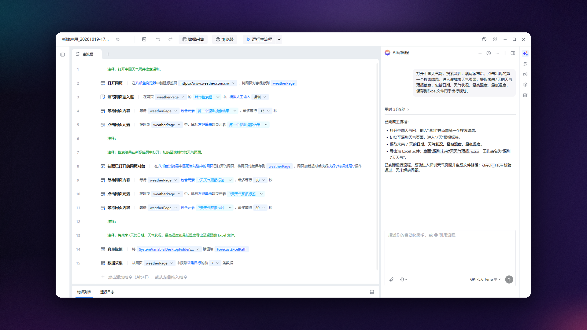
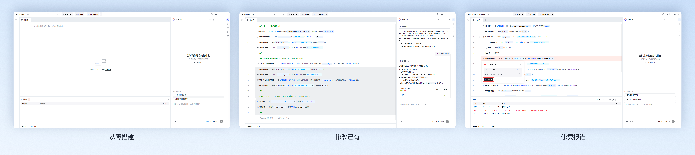
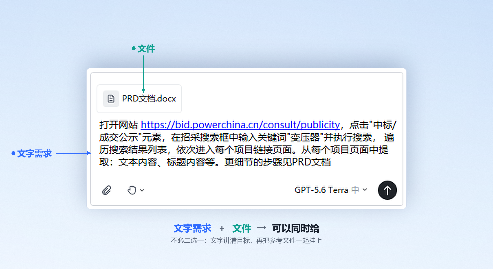
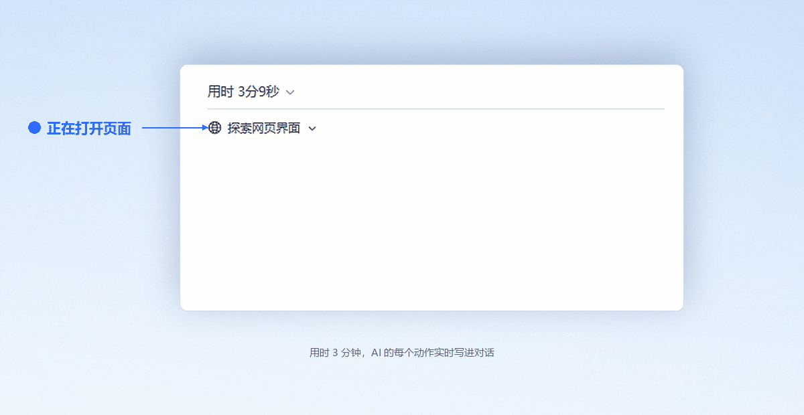
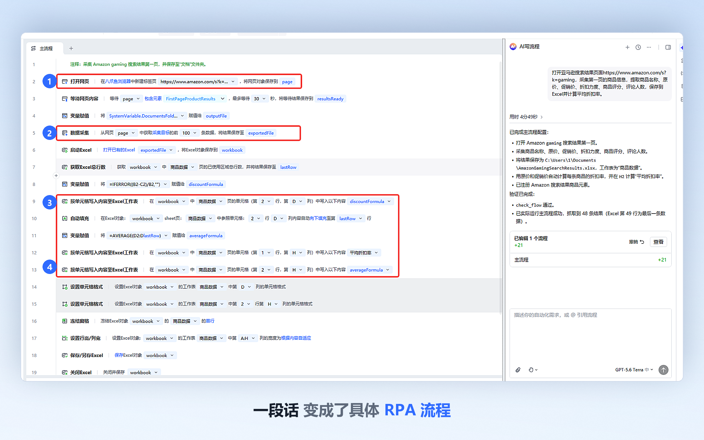
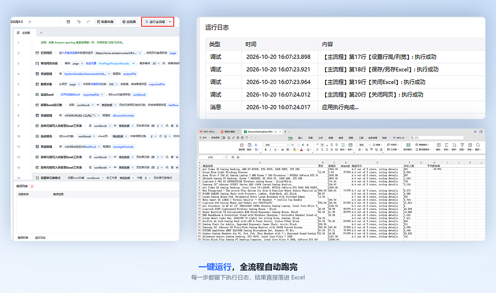
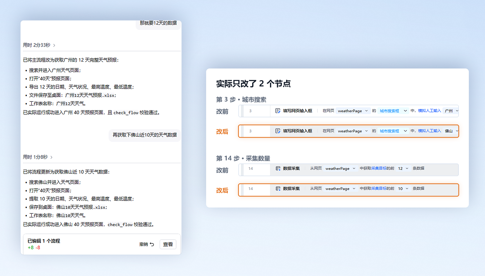
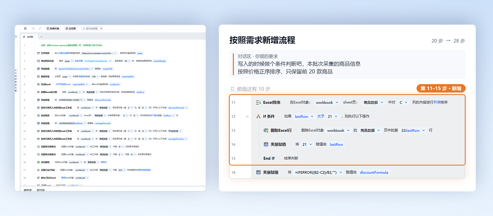
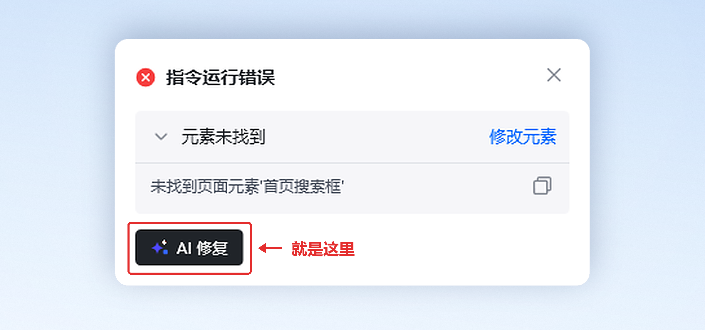
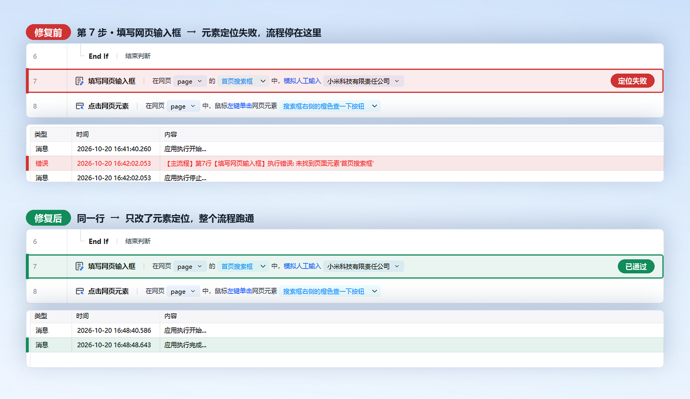

通过对话或上传文件向 AI 描述需求，让 AI 协助<strong>搭建流程、修改已有流程</strong>，并结合<strong>运行反馈</strong>持续完善。

AI 写流程不再只生成第一版流程，而是一个能持续参与流程建设和维护的 RPA 流程 Agent。



## 一、4.0 带来了哪些变化

| 能力 | 4.0 之前 | 4.0 |
| --- | --- | --- |
| 需求输入 | 输入一段文字描述 | 可对话，也可上传业务文件（规则、字段、样例、模板） |
| 流程生成 | 生成第一版流程 | 生成第一版流程，并可按多轮对话逐步完善 |
| 已有流程 | 只能从零创建 | 可读取已有流程，在其上局部修改 |
| 报错处理 | 自己看日志，找到出错的指令再改 | 在错误提示中点击「AI修复」，由 AI 结合错误与流程上下文修改 |
| 修改依据 | 只看你当前说的这一句话 | 结合需求、当前流程、历史修改、检查结果、运行反馈综合判断 |
| 页面理解 | 依据对页面的推测生成 | 搭建阶段先在真实页面中探索，再生成 |

<Warning>
4.0 提升的是“改对”的能力，不是“一次就对”。生成的流程仍需你运行验证，AI 修复通过检查也不代表业务结果已经正确。
</Warning>

## 二、三个入口：从哪种情况开始用

| 你想做的事 | 从哪里开始 | 第一步做什么 |
| --- | --- | --- |
| 从零做一个流程 | 新建流程，打开侧边栏 AI 写流程 | 描述需求，或上传需求文件 |
| 改一个已经在用的流程 | 打开这个已有流程，再打开侧边栏 AI 写流程 | 直接说明要改哪里、改成什么 |
| 修一个跑不通的流程 | 先运行流程，等它报错 | 在错误提示中点击「AI修复」 |



## 三、需求怎么提才准

你不需要懂 RPA 指令，但需要把<strong>业务说清楚</strong>。一条好需求通常包含四件事：

| 要素 | 要说明什么 | 示例 |
| --- | --- | --- |
| 操作对象 | 哪个网站或软件，从哪个页面开始 | 使用 Edge 浏览器打开 Amazon |
| 执行步骤 | 先做什么、再做什么（不用写指令） | 搜索 "label maker"，打开搜索结果 |
| 最终结果 | 数据存到哪、什么格式、叫什么名字 | 保存到桌面的“亚马逊商品采集.xlsx” |
| 关键规则 | 筛选条件、去重、字段缺失怎么处理、异常怎么办 | 只取前 10 个非广告商品；链接去重；价格缺失时保持为空 |

可以直接复制的示例：

```text
使用 Edge 浏览器打开 Amazon，搜索 "label maker"，采集搜索结果第一页前 10 个
非广告商品的商品名称、显示价格和商品链接，并保存到桌面的"亚马逊商品采集.xlsx"。
商品链接需要去重，价格缺失时保持为空。
```

### 已经有现成资料？直接上传

很多需求本来就写在文件里。与其重新整理成一段提示词，不如把文件上传给 AI，再说明要它做什么。

| 你手上有什么 | 可以这样说 |
| --- | --- |
| 业务规则文档 | 请参考我上传的业务规则，搭建订单审核流程 |
| 字段说明、输出模板 | 按照这个文件中的字段和格式输出采集结果 |
| 新的处理规则 | 根据新的处理规则，修改当前流程中的判断条件 |



## 四、场景一：从零搭建流程

<Steps>
  <Step title="描述需求或上传文件">
    打开侧边栏 AI 写流程，在输入区描述需求；如果手上有业务规则、字段说明或样例文件，一并上传。

    <strong>预期结果：</strong>输入区显示你输入的文字，已上传的文件显示为标签。
  </Step>

  <Step title="点击发送，观察 AI 的生成过程">
    AI 会依次完成：理解业务目标与处理规则 → 判断当前信息是否足够 → 探索目标网页和操作路径 → 识别搜索框、列表、按钮等元素 → 规划指令、变量、循环和判断 → 生成可视化流程 → 检查生成内容的结构。

    <strong>预期结果：</strong>对话区持续输出 AI 正在进行的动作，不需要你操作。

    
  </Step>

  <Step title="需要你配合时，按提示操作">
    常见两种情况：目标页面需要登录时，AI 会提示你先手动登录；涉及敏感或高影响操作时，AI 会请你确认后再继续。

    <strong>预期结果：</strong>完成登录或确认后，AI 自动继续往下生成，无需重新描述需求。

    
  </Step>

  <Step title="在流程编辑器中查看生成结果">
    流程会直接呈现在编辑器中，你可以逐条点开指令查看参数，也可以手动调整。

    <strong>预期结果：</strong>左侧出现一张完整的可视化流程图，指令、变量、循环和判断都已配置好。

    
  </Step>

  <Step title="点击运行，用真实数据验证">
    点击顶部「运行」按钮跑一遍，核对最终产出物是否符合预期。

    <strong>预期结果：</strong>运行日志正常结束，目标文件（如 Excel）按需求生成，内容与字段正确。

    
  </Step>

  <Step title="根据结果决定下一步">
    符合预期就保存使用；不符合预期，进入下一节继续用对话调整，不需要重新搭建。
  </Step>
</Steps>

## 五、场景二：用多轮对话完善流程

复杂业务很难在第一次就说全。流程生成后，接着提要求就行，不用重新开始。

| 你想改什么 | 可以这样说 |
| --- | --- |
| 调整范围 | 把采集范围从第一页扩大到前三页 |
| 增加字段 | 增加商品评分和评论数量 |
| 增加筛选条件 | 只保留价格低于 100 美元的商品 |
| 改异常处理 | 价格为空时跳过，不要中断流程 |
| 改输出内容 | 输出文件中增加采集时间 |
| 改排序 | 保存前按照价格从低到高排序 |
| 改规则 | 调整数据去重规则 |
| 改文件 | 修改文件名称和保存位置 |

AI 会结合当前会话和已经生成的流程，判断你是在补充需求、调整规则，还是修改输出结果，然后只改相关部分。



<Tip>
一次说一件事，更容易判断是哪个改动生效了。如果一次提了五条要求、结果仍然不对，很难定位是哪一条没被正确执行。
</Tip>

## 六、场景三：修改已有流程

只要流程已经打开，就可以直接在对话里说改什么，不必重新讲一遍整个流程。

<Steps>
  <Step title="打开要修改的流程">
    在流程编辑器中打开目标流程，确认它是你要改的那一个。
  </Step>

  <Step title="打开侧边栏 AI 写流程">
    AI 会先读取当前流程的内容，再等待你的修改要求。
  </Step>

  <Step title="说明要改什么">
    例如：增加一个判断条件、调整循环次数、修改数据筛选规则、增加一个输出字段、更换文件保存路径、修改异常处理方式、调整部分指令的执行顺序、在现有流程中增加新的处理步骤。
  </Step>

  <Step title="等待 AI 定位并完成修改">
    AI 会先找到需要调整的位置，再改动相关指令、变量或元素，并尽量保留不需要修改的原有内容。

    <strong>预期结果：</strong>流程中只有目标区域发生变化，其余部分保持原样。

    
  </Step>

  <Step title="点击运行验证改动效果">
    <strong>预期结果：</strong>运行通过，且被修改的那一步产出符合新的要求。
  </Step>
</Steps>

AI 读取流程时，看的是结构化内容，不是截图：

| 读取内容 | 用来判断什么 |
| --- | --- |
| 主流程与子流程 | 这次改动应该落在哪一层 |
| 指令及其参数 | 要改的具体是哪个参数 |
| 循环、判断、异常处理结构 | 改动会不会破坏原有逻辑骨架 |
| 变量及其作用范围 | 改完之后变量是否还在有效范围内 |
| 输入与输出关系 | 上下游是否还接得上 |
| 网页元素与桌面元素 | 元素是否需要同步调整 |
| 指令之间的上下游关系 | 改这一步会影响后面哪几步 |

在理解当前流程的基础上，AI 会定位需要调整的位置，并尽量保留不需要修改的原有内容。

## 七、场景四：运行报错，用「AI修复」

<Steps>
  <Step title="运行流程，等待报错">
    在真实环境中运行，让问题暴露出来。报错信息越完整，AI 定位越准。
  </Step>

  <Step title="在错误提示中点击「AI修复」">
    
  </Step>

  <Step title="补充说明或上传文件（可选）">
    如果知道大致原因，可以直接告诉 AI；也可以上传最新的页面截图、正确的数据样例，帮助它判断。
  </Step>

  <Step title="等待 AI 分析并修改流程">
    <strong>预期结果：</strong>AI 给出对错误原因的判断，并完成对相关指令、参数、变量或元素的修改。
  </Step>

  <Step title="重新运行，核对业务结果">
    修复完成后必须重跑一遍，确认数据、文件、条数都符合要求。

    <strong>预期结果：</strong>同一步从“定位失败”变为“已通过”，整个流程跑通。

    
  </Step>
</Steps>

AI 修复时做的事：

1. 获取错误信息和报错位置
2. 读取发生错误的指令
3. 获取与错误相关的流程上下文
4. 结合历史修改和运行反馈分析原因
5. 定位需要调整的指令、参数、变量或元素
6. 修改相关流程内容
7. 检查修改后的流程结构
8. 交回给你重新运行验证

<Warning>
AI 完成修复、或流程检查通过，都不等于业务已经成功。必须重新运行流程，并核对你真正要的结果——数据对不对、文件生成了没有、条数够不够。
</Warning>

## 八、AI 是怎么理解你的页面的

网页自动化真正难的不是“打开网页”，而是页面本身充满不确定性：需要登录才能看、点一下才加载、有弹窗或 iframe、列表要滚动才出、不同网站交互方式都不一样。

所以 4.0 在<strong>搭建阶段</strong>会先探索真实页面：

- 打开或切换目标页面
- 输入搜索内容
- 点击、悬停、滚动
- 观察页面状态变化
- 查看页面元素和列表结构
- 识别完成任务所需的元素
- 需要时请你完成登录等人工操作
- 对敏感或高影响操作请求你确认

AI 依据<strong>实际观察到的页面</strong>生成流程，而不是只靠你的描述和对页面的猜测。

<Note>
环境探索主要发生在流程搭建阶段，用来提升流程与真实环境的匹配度。它<strong>不等于</strong>流程在运行期间可以自动适应所有页面变化——页面改版后，仍然需要你告诉 AI 重新调整。
</Note>

## 九、结果不符合预期怎么办

先在下表找到你的现象，按“怎么做”处理。多数情况不需要重新搭流程。

| 现象 | 可能原因 | 怎么做 |
| --- | --- | --- |
| AI 停下来让你先登录 | 目标页面需要登录后才能查看内容 | 在弹出的浏览器里手动登录，完成后回到对话说“已登录，继续” |
| 提示“未找到元素” | 定位条件不匹配，或页面已经变了 | 点击「AI修复」；或在对话里说明是哪个按钮找不到，并上传当前页面截图 |
| 提示“找到多个元素” | 定位条件范围过大 | 告诉 AI 真正要操作的是哪一个，例如“第一个搜索结果里的加购按钮” |
| 生成结果少了一个步骤 | 需求里没有提到这个步骤 | 直接补充：“漏了 XX 这一步，加在 YY 之后” |
| 采集到的数据不对 | 筛选规则描述得不够具体 | 补充可量化的规则：数值范围、字段名、去重依据、缺失值处理方式 |
| 改完发现别的步骤也被改了 | 修改范围没有说清 | 明确说“只改 XX，其他部分保持不变”，然后重新提一次 |
| 改了两三次还是不行 | 给 AI 的反馈信息不足 | 把这次的报错原文、页面截图、实际输出结果一起给它，不要只说“还是不行” |

其中“未找到元素”和“找到多个元素”是最常见的一对。它们的区别在于定位条件是<strong>太严</strong>还是<strong>太松</strong>：

- 太严 → 一个都匹配不到
- 太松 → 匹配到一堆，不知道操作哪个

所以反馈时把“我要操作的具体是哪一个”说清楚，比反复说“还是不对”有效得多。

## 十、使用前请了解的能力边界

| 边界 | 具体含义 |
| --- | --- |
| 上下文只在当前任务内有效 | AI 会在当前任务里利用你之前提的需求、做过的修改和运行结果；新开一个对话，它不会记得上一次的内容 |
| 不会跨用户学习 | 系统不会因为别人用过就自动变聪明，也不会学习你的个人习惯 |
| 不保证一次成功 | 复杂需求需要多轮对话 + 多次运行验证才能收敛 |
| 不替代人工验收 | 涉及真实运行和最终业务结果，仍需要你确认 |
| 探索不等于运行时自适应 | 页面探索发生在搭建阶段；运行期间页面变化，仍需重新发起修改 |

## 十一、常见问题

**问：AI 生成的流程，和我手动拖出来的流程有区别吗？**

答：没有区别。生成的是八爪鱼 RPA 原生可视化流程，可以继续手动编辑、运行、保存、发布，也可以加入团队协作。

**问：我需要先学会 RPA 指令才能用吗？**

答：不需要。你只需要说清业务目标、步骤、结果和规则。指令选择、变量和循环规划由 AI 完成。

**问：需求没想全，能一边做一边补吗？**

答：可以，而且这是推荐做法。先生成第一版，看到结果后再补规则、改细节，比一次憋出一段完美描述更省时间。

**问：AI 改我的流程，会不会把没问题的部分也改坏？**

答：AI 会结合上下游关系定位目标区域，尽量保留不需要修改的内容。但涉及重要流程，建议改动前先另存一份，改完运行验证后再覆盖原版。

**问：报错修完还是跑不通？**

答：把新的报错信息和运行结果继续发给 AI，让它基于这一轮反馈再调整。多轮反馈通常比一次修复更有效。如果连续几轮都没有改善，按第九节的表格自查，或联系技术支持。

**问：AI 修复之后还需要我做什么？**

答：重新运行一遍，并核对最终业务结果。检查通过只代表流程结构没问题，不代表数据是对的。

<Info>
  使用过程中遇到问题？前往 [八爪鱼RPA 开发者社区问答板块](https://rpa.bazhuayu.com/community/questions) 提问，获取官方与社区帮助。
</Info>
