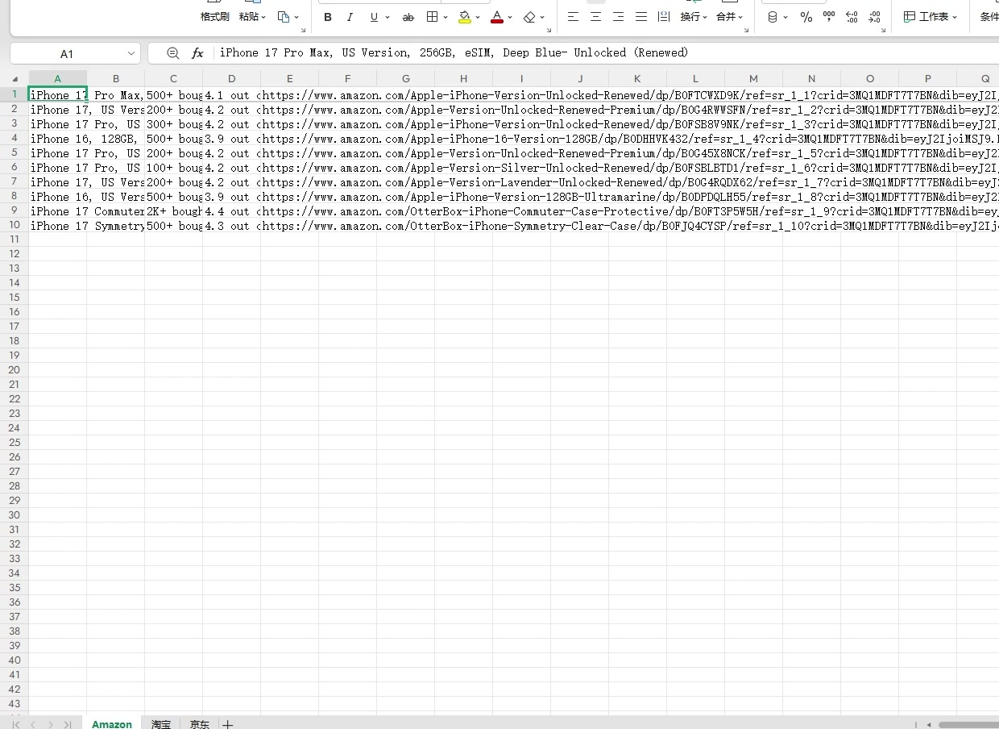
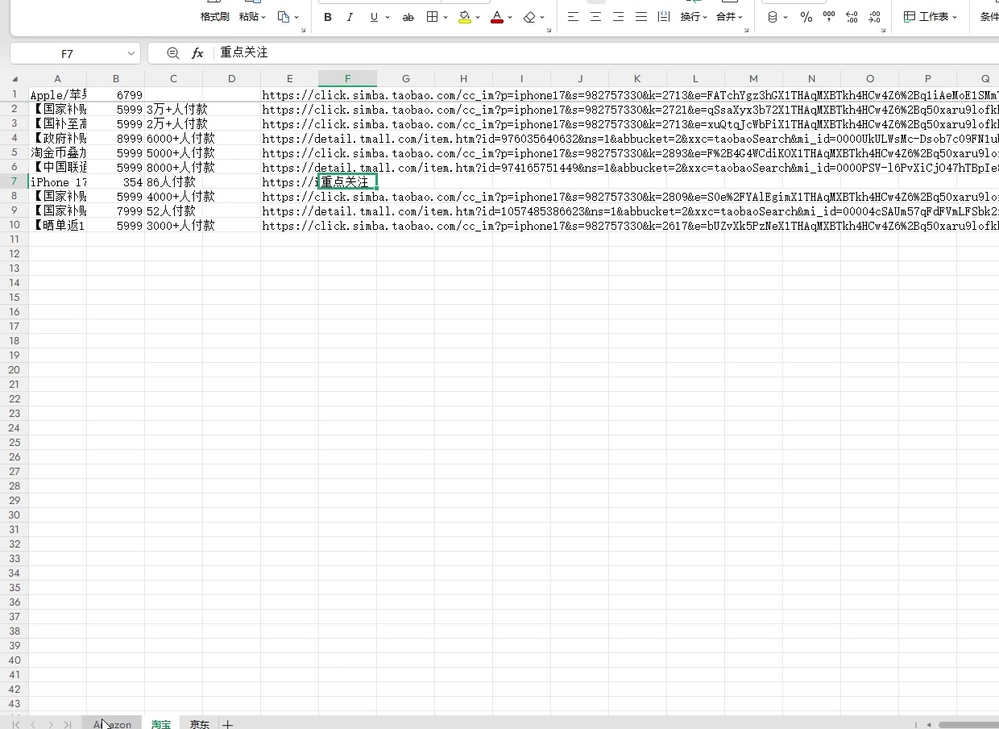
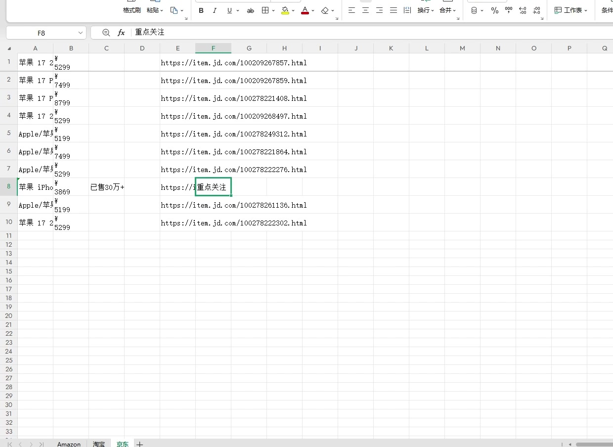
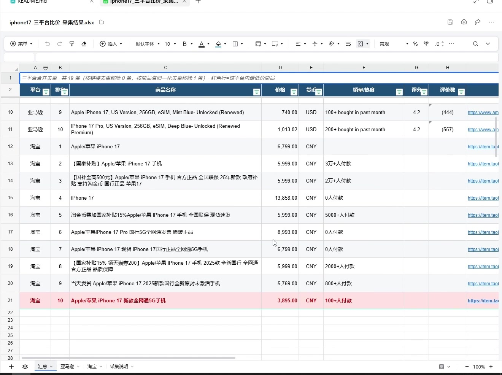
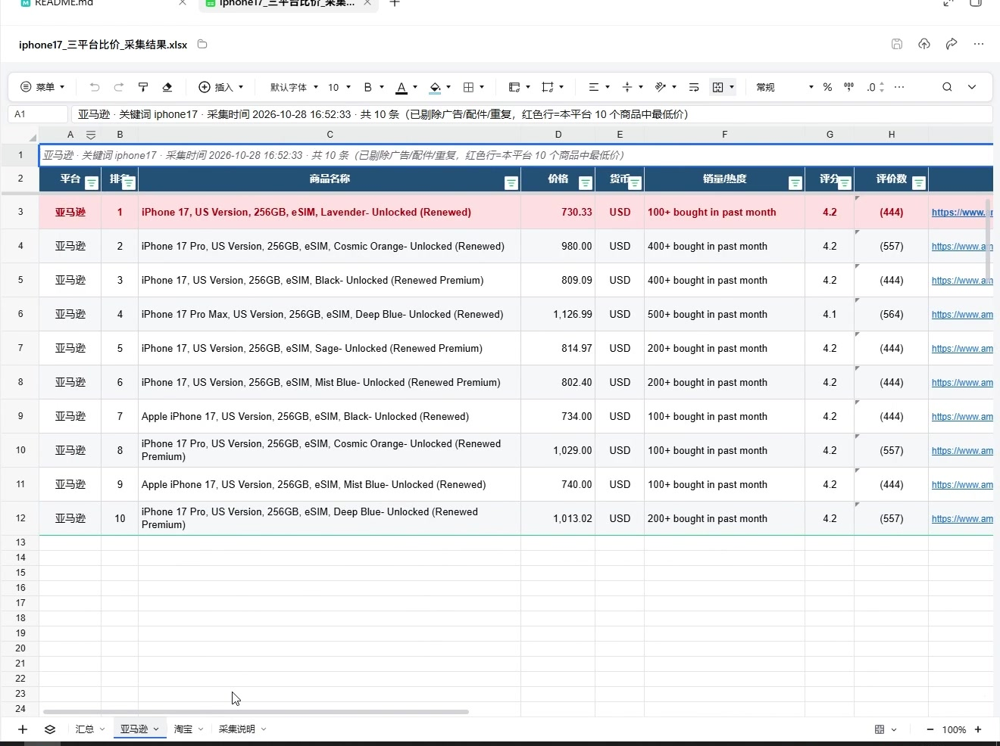
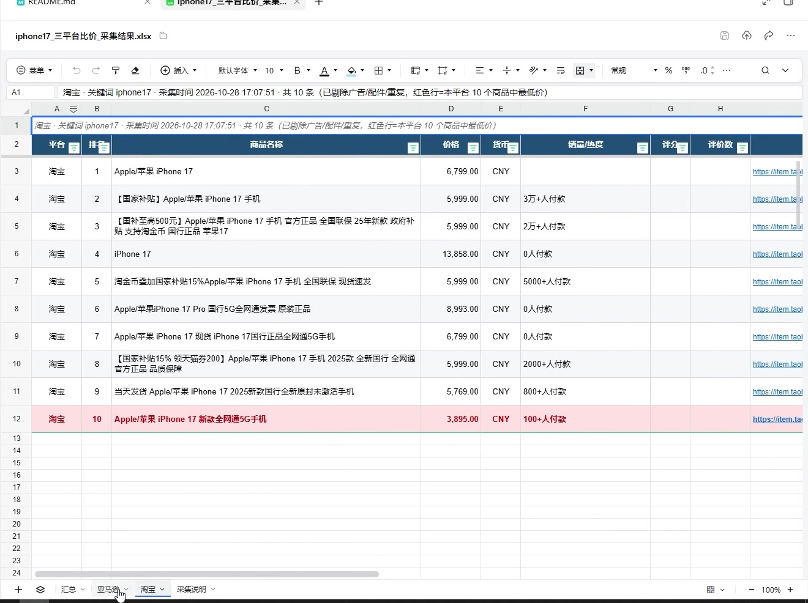
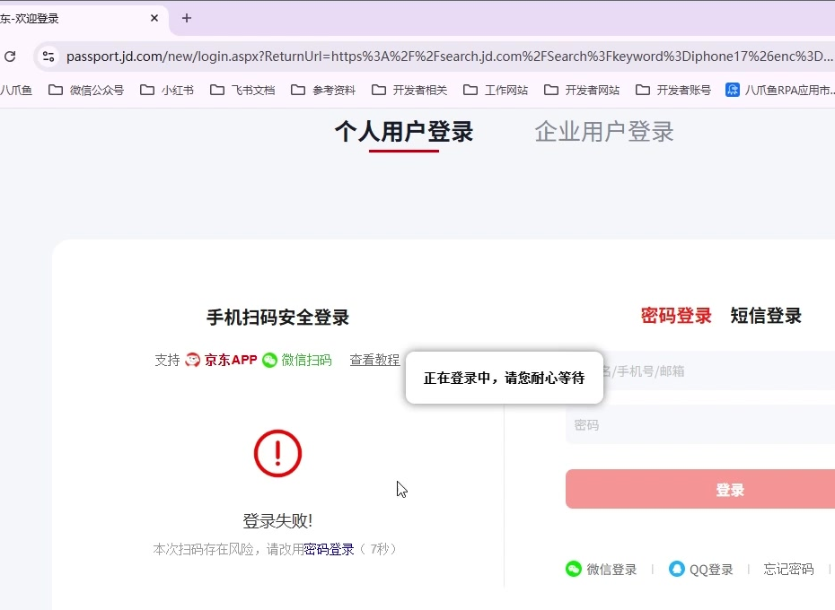

**一句话**：三条路线都能把商品数据拿下来。差别在另外三件事：要不要先搭环境、被平台拦下来还走不走得动、跑完之后别人能不能接手。八爪鱼 RPA 前两件最省事，还留下一份别人看得懂的流程。通用 Agent 交出的表最规整，代价是少一个平台。浏览器技能跑到 56 分钟，额度用完，没交出表。

---

## 一、先看结果

| 路线 | 是否跑完 | 总耗时 | 拿到什么 | 卡在哪 |
| --- | --- | --- | --- | --- |
| **八爪鱼 RPA** | 跑完 | **17.2 分钟**（含调试） | 1 个 Excel，三个 Sheet 各 10 条；流程能重复用，对话全程可回溯 | 没卡住（首次没有表头，补一句重跑就有） |
| **通用 Agent** | 跑完一部分 | **49.5 分钟** | 1 个 Excel（4 个 Sheet，19 条）+ 1 份 README 踩坑记录 | 京东被风控挡住，缺这一个平台 |
| **浏览器技能** | 没跑完 | **56 分钟**（额度用完） | 没见到成品表格（录屏里没有 Excel 画面） | 京东登录提示"环境异常"，额度用完 |

三条路线都能回答"这件事能不能做"，但"做到哪一步"差得很远：

- **八爪鱼 RPA** 是唯一在 20 分钟内交齐三个平台数据的一条。不用装运行环境，也不用看得懂代码，中途的报错交给「AI修复」自己改。它交出来的是一份能重复用的流程，当时的对话也留在客户端里，换个人接手能看懂来龙去脉。这次的表没有表头，三张表的列顺序也不一样。这属于需求没提清，不是做不到：补一句"Sheet 页需要加上表头"，再跑一次就带上。这句话会留在流程里，下次跑、换人跑都生效。
- **通用 Agent** 用了 49.5 分钟，前 15 分钟全花在环境上：装 Playwright、解 Cookie v20 加密、开独立 profile，占了 30%。数据只拿到两个平台。京东一直提示"访问频繁"，换模式、换账号都没过去。
- **浏览器技能** 跑得最久，也没跑完。安装环节最多（CLI、Chrome 扩展、守护进程、连接验证），还得先由人把三个平台的操作完整录一遍。录的过程中扩展反复掉线，录到一半会卡死。

**一句话选型**：今天就要一份能用的跨平台数据，选 RPA。有工程底子、愿意陪京东这种强风控站点反复折腾，选通用 Agent。浏览器技能适合"人已经知道怎么点、只想让机器代劳"的重复动作，最好只做一个平台。

---

## 二、怎么测的

### 2.1 三条路线用同一句话

提示词原样给三条路线，一个字没改：

> 在 Amazon / 淘宝 / 京东分别搜索"iphone17"，采集前 10 个非广告商品的名称、价格、销量、评分、链接；按规则处理（链接去重、价格缺失留空、10 个商品中最低价标记"重点关注"）；三个平台数据合并去重后写入同一张 Excel，按平台分 sheet；遇到登录失效、验证码、弹窗要能自动处理或暂停等人；跑完发通知。

### 2.2 测试条件

| 项 | 内容 |
| --- | --- |
| 测试平台 | 亚马逊、淘宝、京东 |
| 测试日期 | **2026-10-28** |
| 运行环境 | Windows 本机；通用 Agent 和浏览器技能都用本机 Chrome |
| 工具版本 | 八爪鱼 RPA **2.9.21** 通用 Agent **WorkBuddy 5.9.3**（2026-10-27 发布，录屏侧栏也显示 5.9.3） 浏览器技能 **豆包客户端 v2.1.0**（2026-10-14 发布，模型档位 2.1 Pro）+ **BrowserSkill bsk CLI v0.3.3**（2026-10-19 发布）+ Chrome 扩展 |
| 起始登录状态 | 三个平台都没登录，全程人工扫码 |
| 网络环境 | 没记录。京东那两次"访问频繁／环境异常"跟出口 IP 有关，这一项会实质影响结论 |
| 录制方式 | 三条路线全程录屏，没有剪辑干预（这里给的是粗剪版） |

日期是从画面里看出来的：八爪鱼 RPA 16:27 跑完，通用 Agent 的 Excel 记着 16:52:33、17:07:51、17:19:21，浏览器技能录屏到 18:11。三条都在 10 月 28 日。版本号取的是当天已经发出来的最新版。

### 2.3 什么算做完了

"跑完"和"做完"是两回事。按任务要求拆成 7 项，逐条对：

1. 三个平台是不是都取到数据
2. 每个平台是不是满 10 条，并且排掉了广告位
3. Excel 有没有表头
4. 五个字段（名称、价格、销量、评分、链接）齐不齐
5. 链接去重、价格缺失留空有没有生效
6. 最低价有没有标"重点关注"
7. 跑完有没有发通知

这 7 项在第五节的核对表里逐条给了结果。

---

## 三、三条路线跑下来，各自卡在哪

| 节点 | 八爪鱼 RPA | 通用 Agent | 浏览器技能（Browser Skill） |
| --- | --- | --- | --- |
| **安装与配置** | **0 步**。客户端自带「AI写流程」面板，粘贴提示词即可；不装 Python、不配 Cookie | **约 15 分钟**：装 Playwright、破解 Cookie v20 加密、开独立 profile | 装 bsk CLI + Chrome 扩展 + 守护进程，再做连接验证 |
| **首次运行** | AI 在真实页面探索：Amazon → 搜 iphone17 → 读列表；切淘宝弹二维码，暂停等人扫码后继续 | 亚马逊价格全部为空 → 手动设美国邮编 10001 → 修标题选择器 | 人工在 Agent Window 里依次录制亚马逊、淘宝、京东的商品列表页 |
| **调试** | 出现数次报错，全部用「AI修复」自动改写，未手工改指令 | 京东"访问频繁"block 20 分钟，换模式／换账号均无效；淘宝 iframe 登录弹窗检测失败 → 重写选择器才拿到 10 条 | 调 JSON 解析、evaluate 返回值、wait_ms；录制中扩展反复掉线、超时、需手动重连 |
| **人工接手** | 2 次扫码：淘宝、京东各 1 次，其余无需干预 | 环境配置、登录态处理，以及上述所有卡点的判断 | 三平台全程录制；京东另需改用微信登录 |
| **总耗时** | **17.2 分钟**（含调试） | **49.5 分钟**（含前 15 分钟环境） | **56 分钟**（额度耗尽，任务未完） |
| **结束状态** | 提示「采集完成」，桌面弹出通知，Excel 三平台各 10 条、无表头；流程与对话全程留在客户端 | 亚马逊 10 + 淘宝 10 = 19 条，京东缺失；Excel 4 Sheet + README | 京东扫码报"登录失败！本次扫码存在风险"，扫码页不刷新；未产出表格 |

### 3.1 八爪鱼 RPA：省了哪些事，留下了什么

**省掉的**：运行环境、代码能力、登录态处理，还有判断报错原因这件事——报错由「AI修复」自己改。中途京东的卡片结构和预想的不一样，报了"未找到页面元素 relative_element"。AI 给这一步加了兜底：标题取不到就把商品名留空，由后面"名称非空"的判断跳过这张卡片，整个流程不中断。

**留下的**：一份能交给别人的流程。生成的指令流程可以重复用，对话全过程也留在流程里。当初需求怎么提的、哪一步报了什么错、AI 把哪条指令改成了什么，下一个人打开就能顺着看下来，不用再找人问"这流程在干什么"。以后这件活要重跑，或者要换人接手，这份记录比省下来的 15 分钟环境配置有用得多。

**这次没做到的**：第一版没有表头，三张表列序也不一致。这不代表它做不到——在对话里补一句"Sheet 页需要加上表头"，再跑一次就带上。改的是流程本身，不是某一次的表，所以下次跑、换人跑都生效，代码一行都不用碰。

### 3.2 通用 Agent：换来什么，付出什么

**换来的**：整条链路的代码都在自己手里，出问题能看到是哪一行。README 和「采集说明」Sheet 是三条路线里唯一把过程写下来的——京东为什么失败、去重和价格怎么定的，表格里都有。

**付出的**：前 15 分钟的环境成本躲不开，和任务难不难没关系。跟风控磨的时间没法预估，京东一项就吃掉 20 分钟。另外，用的人得看得懂 Python 和 Playwright，否则 AI 在做什么、改了什么，判断不了。

### 3.3 浏览器技能：前提是什么，代价是什么

**前提**：得先有一份"人对的操作轨迹"。录得好不好，直接决定生成得好不好。实际运行时它并没有完全照着录的走（比如跳过了商品详情页），说明录下来的轨迹和真正执行之间还有偏差。

**代价**：安装环节最重。扩展撑不住 56 分钟的长任务。Token 花到额度用完也没出结果，单个任务的成本最高。

---

## 四、六个要素，横向摆一遍

| 要素 | 八爪鱼 RPA | 通用 Agent | 浏览器技能（Browser Skill） |
| --- | --- | --- | --- |
| **明确结论** | 能做完，三个平台数据齐全，还留下一份能重复用、能追溯的流程；表头差一句需求 | 能做一部分，缺京东这一站，但表本身最规整 | 没做完，没交出能用的结果 |
| **适用场景** | 跨平台采集、要留下能重复用的流程、团队里没有工程角色、登录可以人工扫码、**这件事以后要重跑或者要交给别人** | 一次性探索性任务、有工程能力、能接受反复调试、需要看清每一步在做什么 | 已有稳定的人工操作轨迹、要复用本机 Chrome 登录态、单平台重复动作多 |
| **实现方式** | 自然语言 → AI 探索真实页面 → 生成 121 行可视化指令 → 运行 + AI 修复。**现成功能，零安装** | 自然语言 → AI 写 Python / Playwright → 反复调试。**定制实施，要自建环境** | 人工录制轨迹 → AI 写 389 行脚本 → 借本机登录态执行。**半模板 + 定制，要装 CLI 与扩展** |
| **使用条件与边界** | 需人工扫码 2 次；第一版没带表头，补一句需求重跑就生效，改动留在流程里；强风控站点这次没单独试 | 要会 Python / Playwright；这次京东没过去；本地登录态不会自动带到下一次 | 安装环节最长（CLI + 扩展 + 守护进程 + 连接验证）；扩展掉线会中断长任务；Token 消耗大，额度可能先于任务用完 |
| **证据** | 录屏 `多平台商品比价-八爪鱼RPA-粗剪_压缩版.mp4`（17:08） | 录屏 `多平台商品比价-常见Agent-粗剪_压缩版.mp4`（49:32）；Excel 4 Sheet + README | 录屏 `多平台商品比价-BrowserSkill-粗剪.mp4`（56:19）；没有表格画面 |
| **实际输出** | 1 个 Excel，3 个 Sheet 各 10 条；外加流程本身和完整对话 | 1 个 Excel，4 个 Sheet 共 19 条（缺京东），**有表头 + 采集说明**，最低价用红色高亮 | 没见到成品表格；工作进度停在"编写采集脚本" |

"总耗时"是当时记下的数字（17.2、49.5、56 分钟），"证据"栏是录屏文件的实际长度。两边最多差 50 秒，是粗剪时剪掉的，不影响判断。

---

## 五、结果逐条对一遍

| 核对项 | 八爪鱼 RPA | 通用 Agent | 浏览器技能 |
| --- | --- | --- | --- |
| 三个平台都取到 | ✅ 三个 Sheet 都在（Amazon／淘宝／京东） | ❌ 缺京东，采集说明写明被限流 4 次仍失败 | ❌ 没走到这一步 |
| 每平台满 10 条 | ✅ 三张表都是第 1–10 行有数据，第 11 行起为空 | 亚马逊 10、淘宝 10、京东 0 | ❌ 没有成品可数 |
| 排掉广告位商品 | ❌ 淘宝 10 条里有 5 条是广告跳转链接 | ✅ 采集说明记着"页面抓到 48 条 → 剔除广告 0 条、配件 0 条" | — |
| Excel 有表头 | ❌ 这次三张表都没有；补一句需求重跑就带上 | ✅ 第 2 行是表头，第 1 行是采集说明 | — |
| 五个字段齐全 | ⚠️ 名称、价格、销量、链接都有；评分只有亚马逊有，三张表列序还不一致 | ✅ 平台／序号／商品名／价格／货币／销量／店铺／评分／评价数 + 链接 | — |
| 链接去重生效 | ⚠️ 有 2 条指向同一个 Tmall 商品 id（skuId 不同） | ✅ 汇总 19 条 = 亚马逊 9 + 淘宝 10，写明"去重移除 1 条" | — |
| 价格缺失留空 | ✅ 亚马逊价格整列为空，没有补值 | ✅ 采集说明写明"价格缺失一律留空，不做补值或估算" | — |
| 最低价标"重点关注" | ✅ 淘宝第 7 行 ¥354、京东第 8 行 ¥3869 都标了"重点关注" | ⚠️ 改成红色整行高亮，没写"重点关注"四个字 | — |
| 跑完发通知 | ✅ 弹出桌面通知"采集完成，Excel 已保存至桌面" | ✅ 桌面通知 + 另存「采集完成通知.txt」 | ❌ 没走到这一步 |

表里"—"是这条路线没走到这一步，不参与对比；"⚠️"是做出来了，但和需求有出入，具体在下面三小节。

### 5.1 八爪鱼 RPA：三张表都在，表头补一句就有

三个 Sheet 都在，每张都是第 1–10 行有数据，第 11 行起为空，也就是每个平台 10 条。这次的表没有表头，三张表的列顺序也不一样。原因是需求里没写，不是做不到：补一句"Sheet 页需要加上表头"，重跑一次就带上，改动会留在流程里。下面这些图拍的是第一次跑出来的样子，不是它的上限。

**亚马逊（10 条，价格整列为空）**

列的顺序是：A 商品名 → B 销量（500+／200+／2K+）→ C 销量文案（bought in past month）→ D 评分（4.1／4.2／3.9）→ E 配送状态（out）→ F 链接。**没有价格列**，这与提示词"价格缺失留空"一致，只是它没有留出空列，而是整列不存在。

**淘宝（10 条，最低价已标记）**

列的顺序是：A 商品名 → B 价格 → C 付款人数 → E 链接 → F"重点关注"。第 7 行 iPhone 17（¥354）是全表最低价，公式栏显示 F7 的值是"重点关注"。

这张表还露出两个问题。**10 条里有 5 条是 `click.simba.taobao.com` 广告跳转链接**（第 1、2、5、8、10 行），说明"取前 10 个非广告商品"这条没做到。另外第 6 行和第 9 行的链接指向同一个 Tmall 商品 id（skuId 不同），按链接去重的规则，这两条应该合并。

**京东（10 条，最低价已标记）**

列的顺序是：A 商品名 → B 价格 → C 销量 → E 链接 → F"重点关注"。第 8 行 ¥3869 是全表最低价。销量列只有第 8 行有值（已售30万+），其余为空。这部分数据来自 AI 修复后的兜底：京东部分结果卡片结构不一样，标题取不到就跳过这张卡片，不中断整个平台的采集。

**完成通知**

流程最后一条指令是「显示消息通知」。运行时弹出了系统通知："采集完成，Excel 已保存至桌面：D:\Users\1\Desktop\iphone17商品采集.xlsx"。三条路线里只有它做成了系统通知。

**跑完留下的不只是表**

跑完之后留在客户端的，不是一张表和一段用完就丢的脚本，而是一套能重复用的流程，加上整个过程的对话。前面说的京东第 70 行报错、"relative_element 未找到"、AI 怎么给它加兜底，这些取舍都留在对话里。下一个人接手时不用问"这步为什么这么写"，翻对话就能看到当时的报错原文和修改理由。另外两条路线没有这个东西：通用 Agent 靠手写 README 记踩坑，浏览器技能什么都没留下。

### 5.2 通用 Agent：表最规整，但少一个平台

最后交了 4 个 Sheet：汇总／亚马逊／淘宝／采集说明。每个平台表的第一行是采集说明，第二行才是表头——三条路线里只有它做到"打开就能直接看"。

汇总表 A1 写着："共 19 条（按链接去重移除 0 条，按商品名归一化去重移除 1 条）"，也就是亚马逊 9 条加淘宝 10 条。表头是平台／序号／商品名称／价格／货币／销量／店铺名称／评分／评价数，右边还有链接列。最低价用**红色整行**标出来（第 21 行淘宝 10，¥3,895），没有按提示词写"重点关注"四个字——这是唯一一处和需求不一致的地方。

京东为什么缺，Excel 自己给了答案。「采集说明」Sheet 里有一行「京东 状态」，原话是：

> ❌ 未采集成功：京东 search.jd.com 返回「抱歉，由于访问…」，4 次（200s/320s/460s）仍被限；京东 H5 搜索则要求移动端…

同一张表还写了几条规则：

- 去重：同平台内按规范化链接去重，京东取 sku，淘宝／天猫取 id
- 价格：缺失一律留空，不做补值
- 销量：三个平台的算法不一样，不能横向比
- 评分：京东和淘宝的搜索结果页不展示评分

有了这份说明，"缺京东"从"没做成"变成了"能复现的失败"。

### 5.3 浏览器技能：录屏里始终没出现表格

这条路线跑了 56 分钟，录屏里**没有出现任何 Excel 画面**。最后一帧停在京东商品列表页。工作进度面板上，"录制三平台搜索操作轨迹"已经完成，"编写采集与处理脚本""执行三平台自动采集并交付"都还没完成。

卡在登录：京东扫码后弹出"登录失败！本次扫码存在风险，请改用密码登录（7 秒）"。改用密码登录后，扫码页不再刷新。原始记录里有"Excel 已落盘、结果不完整"这一条，这次录屏里找不到对应画面，所以降为**待核**：既不能算这条路的成绩，也不能反过来当成它失败的证据。

---

## 六、这三条路线，分别适合谁

- **八爪鱼 RPA**：适合业务同学直接上手、当天要出数、并且**这件活以后还要重跑或者要交给别人**的场景。它的时间成本几乎不随平台数量增长，留下的流程和对话也让"换人接手"不必从头再讲一遍。第一版格式不对，补一句话重跑就行，这笔成本只付一次。
- **通用 Agent**：适合有工程背景的人做长期可控的采集，愿意为某个站点的风控反复投入。上限更高，但前 15 分钟的环境成本固定，绕不过去。
- **浏览器技能**：适合"人已经知道怎么点、只是想让机器替自己点"的重复动作，尤其是要复用本机登录态的单平台任务。跨平台长任务的稳定性目前不够。

---

## 七、千牛 Claw 为什么没放进同一张表

千牛 Claw 走的是官方接口，不模拟页面点击，所以它和上面三条不是同一类东西：不会碰页面风控，也没有环境搭建这回事。

但它只能在平台自己的生态里做事，做不了跨平台。这次的任务是"三个平台合并到一张 Excel"，它满足不了。

计费按 Token 算：商家调用 AI 完成一项经营动作，就消耗 Token。费用由商家自己承担，或者由商家和服务商一起承担。

这次没有按同一个任务测千牛 Claw。以上只是说明它是什么，不能和上面三列的成绩直接比。
